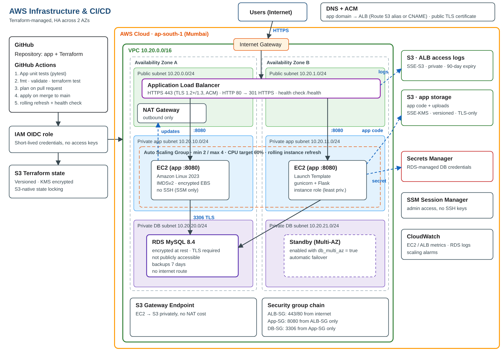

# AWS Infrastructure & CI/CD with Terraform

Highly available web application on AWS, provisioned entirely with Terraform and deployed through a GitHub Actions pipeline.

**Flow:** Internet → Application Load Balancer (HTTPS) → EC2 Auto Scaling Group (private subnets, 2 AZs) → RDS MySQL (private subnets), with ALB access logs in S3 and database credentials in AWS Secrets Manager.



| Item | Location |
|---|---|
| Application source code | [`app/`](app) |
| Terraform infrastructure | [`terraform/`](terraform) |
| Bootstrap (state bucket + GitHub OIDC role) | [`terraform/bootstrap/`](terraform/bootstrap) |
| GitHub Actions workflow | [`.github/workflows/terraform.yml`](.github/workflows/terraform.yml) |
| Architecture diagram | [`docs/architecture.png`](docs/architecture.png) ([SVG](docs/architecture.svg)) |
| Design decisions | [`docs/DESIGN.md`](docs/DESIGN.md) |
| Screenshots | [`docs/screenshots/`](docs/screenshots) |
| End-to-end validation script | [`scripts/validate.sh`](scripts/validate.sh) |

**Working URL:** https://devops-task.deepaisetu.online

---

## 1. What gets built

| Layer | Resources |
|---|---|
| **Networking** | VPC `10.20.0.0/16`; 2 public, 2 private-app and 2 private-DB subnets across 2 AZs; Internet Gateway; NAT Gateway; separate route tables (DB subnets have **no internet route**); S3 gateway endpoint |
| **Load balancing** | Internet-facing ALB in public subnets; HTTPS 443 with an ACM certificate and the `ELBSecurityPolicy-TLS13-1-2-2021-06` policy; HTTP 80 → 301 redirect to HTTPS; target group health check on `/health`; access logs to S3 |
| **Compute** | Launch Template (Amazon Linux 2023, IMDSv2 required, encrypted gp3 root volume, no SSH key); Auto Scaling Group in private subnets (min 2 / max 4), ELB health checks, CPU target-tracking at 60%, rolling instance refresh on every code or config change |
| **Database** | RDS MySQL 8.4 in private DB subnets; storage encrypted; `require_secure_transport = 1` (TLS only); not publicly accessible; 7-day backups; optional Multi-AZ |
| **Secrets** | `manage_master_user_password = true`: RDS generates the password and stores it in **AWS Secrets Manager**. It never appears in code, variables or Terraform state |
| **IAM** | EC2 role: read only *this* secret, read app code from `app/*`, read/write only `uploads/*`, plus SSM Session Manager. GitHub Actions role via **OIDC**, limited to this repo and to project-prefixed IAM roles |
| **Storage** | App bucket (SSE-KMS, versioned, TLS-only policy, public access blocked); ALB log bucket (SSE-S3, which is what ALB supports; 90-day expiry; public access blocked) |
| **CI/CD** | App unit tests → `fmt` → `validate` → `terraform test` (security assertions) → `plan` on PR → `apply` on merge to `main` → wait for instance refresh → HTTPS health check |

---

## 2. Prerequisites

- AWS account and the AWS CLI configured with admin credentials (for the one-time bootstrap only)
- Terraform **≥ 1.10** (S3-native state locking)
- A GitHub repository for this code
- A domain or subdomain you control, e.g. `devops-task.yourdomain.com`, hosted in Route 53 *or* at another DNS provider such as GoDaddy

---

## 3. Deployment

### Step 1: Bootstrap (one time, from your machine)

Creates the encrypted, versioned state bucket, the GitHub OIDC provider and the deploy role.

```bash
cd terraform/bootstrap
terraform init
terraform apply -var="github_repo=<github-user>/<repo-name>"
```

Note the two outputs: `state_bucket` and `github_actions_role_arn`.

### Step 2: Configure GitHub

In **Settings → Secrets and variables → Actions**:

| Type | Name | Value |
|---|---|---|
| Secret | `AWS_ROLE_ARN` | `github_actions_role_arn` from step 1 |
| Variable | `TF_STATE_BUCKET` | `state_bucket` from step 1 |
| Variable | `AWS_REGION` | `ap-south-1` |
| Variable | `DOMAIN_NAME` | e.g. `devops-task.yourdomain.com` |
| Variable | `ROUTE53_ZONE_ID` | Hosted zone ID, or leave unset for GoDaddy or other DNS |
| Variable | `DB_BACKUP_RETENTION_DAYS` | `1` on an AWS **Free plan** account (default `7`) |
| Variable | `DB_MAX_ALLOCATED_STORAGE` | `0` on an AWS **Free plan** account (default `50`) |

In **Settings → Environments**, create an environment called `production`. Optionally add yourself as a required reviewer to get a manual approval gate before `apply`.

### Step 3: Certificate DNS validation

**With Route 53** (`ROUTE53_ZONE_ID` set): nothing to do. Terraform creates the validation and alias records.

**With GoDaddy or other DNS:** create the certificate first, add its CNAME, then deploy everything:

```bash
cd terraform
cp backend.hcl.example backend.hcl            # fill in the state bucket name
cp terraform.tfvars.example terraform.tfvars  # fill in domain_name
terraform init -backend-config=backend.hcl
terraform apply -target=aws_acm_certificate.app
terraform output acm_validation_records       # add this CNAME at GoDaddy
```

### Step 4: Deploy

Push to `main`, or run the workflow manually (**Actions → Terraform CI/CD → Run workflow → apply**).
The pipeline plans, applies, waits for the rolling instance refresh, and then checks `https://<domain>/health` and `/db`.

The first apply takes about 15–20 minutes, mostly for RDS and the ACM certificate.

**Without Route 53**, after the first apply add a **CNAME** at your DNS provider: `devops-task` → `alb_dns_name` output.

You can also deploy locally with `terraform apply` using the same `backend.hcl`.

### Step 5: Validate

```bash
./scripts/validate.sh
```

This checks: HTTPS 200 on `/health`, RDS connectivity on `/db`, HTTP → HTTPS 301 redirect, a valid certificate, TLS 1.1 rejected, at least 2 healthy targets, instances in at least 2 AZs, and requests balanced across instances.

---

## 4. CI/CD pipeline

```
pull request ──► app tests ─► fmt ─► validate ─► terraform test ─► plan (summary in PR checks)
merge to main ─► same checks ─► plan ─► [production approval] ─► apply the saved plan
                ─► wait for ASG instance refresh ─► HTTPS health + DB check
manual        ─► plan | apply | destroy (workflow_dispatch)
```

- **No AWS keys in GitHub.** The workflow gets short-lived credentials through OIDC, and the role trusts only this repository's PRs, `main` branch and `production` environment.
- **Apply uses the exact reviewed plan**, passed as an artifact together with the provider lock file.
- **App deployment is part of the infrastructure.** A change to `app/` changes its content hash, which creates a new launch template version, which triggers a zero-downtime rolling instance refresh (min 50% healthy).
- `concurrency` and S3 state locking prevent two runs from changing state at the same time.

---

## 5. Security and best practices

| Requirement | Implementation |
|---|---|
| Encryption at rest | RDS storage encrypted · EBS encrypted · S3 SSE-KMS (app, state) and SSE-S3 (ALB logs) · Secrets Manager (KMS) |
| Encryption in transit | HTTPS only at the ALB (TLS 1.2/1.3) · RDS requires TLS and the app verifies the RDS CA · S3 buckets deny non-TLS requests |
| HTTPS-only access | Port 80 only redirects to 443 |
| Secrets Manager | RDS-managed master secret; the app fetches it at runtime with its instance role and caches it for 5 minutes, so rotation is picked up automatically |
| Least-privilege IAM | Instance role limited to one secret ARN and specific S3 prefixes; GitHub role limited to project services and project-prefixed IAM roles; no SSH keys (SSM Session Manager instead) |
| Private database | DB subnets with no internet route; `publicly_accessible = false` |
| Restricted security groups | ALB ← internet (443/80) · App ← ALB SG only (8080) · DB ← App SG only (3306); SG-to-SG references, not CIDR ranges |
| Instance hardening | IMDSv2 required, app runs as a non-root systemd service with `NoNewPrivileges` and `ProtectSystem` |
| IaC quality | Remote encrypted state with locking, `fmt`/`validate`, offline `terraform test` suite asserting the controls above |

Run the security tests locally (no AWS account needed): `cd terraform && terraform init -backend=false && terraform test`

---

## 6. Cost and clean-up

Assessment defaults minimise cost: `t3.micro` × 2, `db.t3.micro` single-AZ, **one** NAT Gateway. NAT Gateway, ALB and RDS are billed hourly even when idle, so expect a small daily cost while the stack is running.

Production settings: `single_nat_gateway = false`, `db_multi_az = true`, `db_deletion_protection = true`.

**Destroy when the review is complete:**

```bash
# GitHub: Actions → Terraform CI/CD → Run workflow → destroy
# or locally:
cd terraform && terraform destroy
```

The bootstrap state bucket has `prevent_destroy`. Delete it manually afterwards if you no longer need it.

---

## 7. Troubleshooting

| Symptom | Check |
|---|---|
| Apply waits on `aws_acm_certificate_validation` | The validation CNAME isn't in DNS yet. Run `terraform output acm_validation_records` |
| Targets unhealthy | SSM into an instance: `sudo cat /var/log/app-bootstrap.log`, `sudo journalctl -u app` |
| `FreeTierRestrictionError` creating RDS | AWS Free plan account: set `db_backup_retention_days = 1` and `db_max_allocated_storage = 0` (and the matching GitHub variables) |
| `/db` returns 503 | Instance role can read the secret? DB SG allows the app SG? Check `journalctl -u app` |
| No ALB logs | Logs are delivered every 5 minutes under `alb/AWSLogs/<account-id>/` |
| Pipeline `Not authorized to perform sts:AssumeRoleWithWebIdentity` | Check the `AWS_ROLE_ARN` secret, the `production` environment name and the `github_repo` value used in bootstrap. CloudTrail `AssumeRoleWithWebIdentity` events show the exact subject GitHub sent; the trust policy accepts both the classic and the ID-based (`OWNER@id/REPO@id`) formats |

## 8. Possible next steps

AWS WAF on the ALB · CloudWatch alarms with SNS notifications · RDS Proxy · VPC flow logs · container-based deployment (ECS/EKS) · separate dev/stage/prod workspaces.
